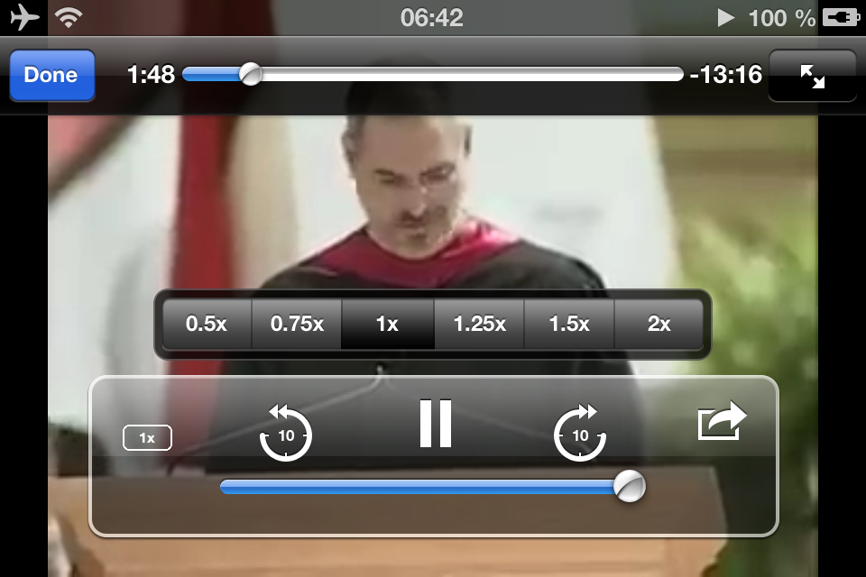

# VideoControls+

<p align="center">
  <br><br>
  <b>Modern Skip & Playback Speed Controls for iOS 6.0 – 6.1.6 Media Player</b><br>
  <i>Pixel-perfect skeuomorphic 10s skip buttons and horizontal speed selector HUD for legacy iOS.</i>
</p>

<p align="center">
  <a href="https://noname122021.github.io/cydia-repo/#videocontrolsplus"></a>
</p>

<p align="center">
  
  
  
</p>

<p align="center">
  <a href="README.md"><b>English</b></a> • <a href="README.ru.md"><b>Русский</b></a>
</p>

> ### 📦 **[Open VideoControls+ in Cydia Repository](https://noname122021.github.io/cydia-repo/)**
> - **One-Tap Cydia Source:** [Add Source to Cydia (`cydia://`)](cydia://url/https://cydia.saurik.com/api/share#?source=https://noname122021.github.io/cydia-repo/)
> - **Cydia APT URL:** `https://noname122021.github.io/cydia-repo/`

---

## Overview

**VideoControls+** revives and modernizes the native media player (`MediaPlayer.framework`), which powers MobileSafari, Classic YouTube, Videos.app, and WebKit video playback on iOS 6.0 through iOS 6.1.6.

It replaces the archaic, useless chapter/track skip buttons with discrete **±10-second skip** buttons featuring Apple's original circular arrow skeuomorphic styling. Additionally, it repurposes the unused bookmark button in fullscreen landscape into a modern, fast **horizontal playback speed selector HUD** (`0.5x` to `2.0x`).

---

## Key Features

- **±10s Skip Buttons (Discrete Step)**
  - Replaces previous/next track buttons with pixel-perfect circular ±10s arrows (`prev30` geometry).
  - High-quality Retina `@2x` and native 1x assets matching iOS 6 etched aesthetics.
  - Fast tap response with intelligent hardware seek turnaround protection.
  - Blocks continuous seeking lockup on long press.

- **Horizontal Speed HUD (`0.5x`, `0.75x`, `1.0x`, `1.25x`, `1.5x`, `2.0x`)**
  - **No scrolling required**: all 6 speed presets fit in a single row using a native `UISegmentedControl` in `UIBarStyleBlackTranslucent`.
  - Exactly **1 tap** to select any speed (including 2.0x).
  - Floating HUD floats right above the transport bar and auto-dismisses smoothly after selection or inactivity.
  - Dynamic button badge in the player toolbar continuously shows the active speed multiplier.

- **Playback Rate Preservation**
  - Hooks `-[AVPlayer setRate:]` so playback speed does not unexpectedly reset to 1.0x when pausing, scrubbing the seek slider, or skipping.
  - Changing speed while paused keeps the player paused until manually resumed.
  - Automatically resets to standard `1.0x` when a new video or stream begins.

- **Zero Layout Breakage in Portrait**
  - Speed button is kept strictly in fullscreen landscape, preventing compact portrait bars from overflowing or clipping.

---

## Compatibility

- **iOS Versions:** iOS 6.0, 6.1, 6.1.2, 6.1.3, 6.1.6.
- **Architectures:** 32-bit ARMv7 (iPhone 3GS, iPhone 4, iPhone 4S, iPhone 5, iPod touch 3G/4G/5G, iPad 1/2/3/4/mini 1).
- **Substrate:** MobileSubstrate / Cydia Substrate / ElleKit.

---

## AI Disclosure

This project was developed with assistance from Large Language Models (AI) for code authoring, debugging, and reverse engineering guidance, then manually inspected, refined, and tested on real jailbroken hardware (iPhone 4 and iPad mini on iOS 6.1.2).

---

## Installation

### Via Cydia (Recommended)
1. Open **Cydia** on your jailbroken device.
2. Go to **Manage** → **Sources** → **Edit** → **Add**.
3. Enter repository URL: `https://noname122021.github.io/cydia-repo/`
4. Search for **VideoControls+** and tap **Install**.

### Manual DEB Installation
Download `com.noname122021.videocontrolsplus_1.0.2_iphoneos-arm.deb` from the [Releases](https://github.com/noname122021/videocontrolsplus/releases) tab and install via terminal / iFile:
```bash
dpkg -i com.noname122021.videocontrolsplus_1.0.2_iphoneos-arm.deb
killall -9 YouTube MobileSafari Videos
```

---

## Building from Source

### Prerequisites
- [Theos](https://theos.dev/) development suite.
- iOS SDK 6.1+ with ARMv7 support.

```bash
git clone https://github.com/noname122021/videocontrolsplus.git
cd videocontrolsplus/tweak
make clean package FINALPACKAGE=1
```

---

## License
MIT License. Created by noname122021.
